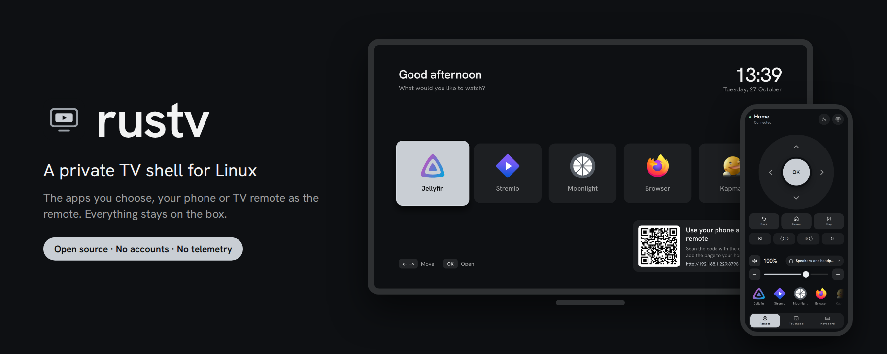
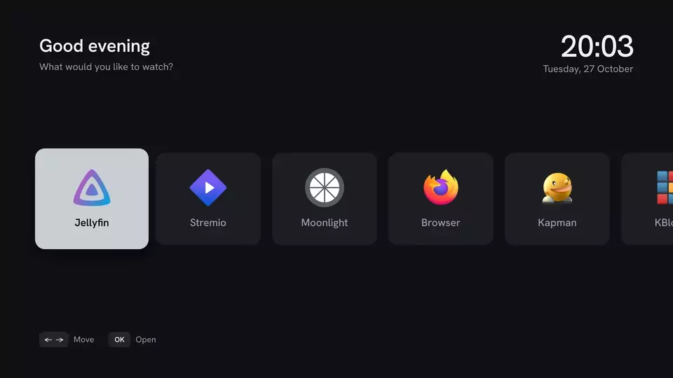
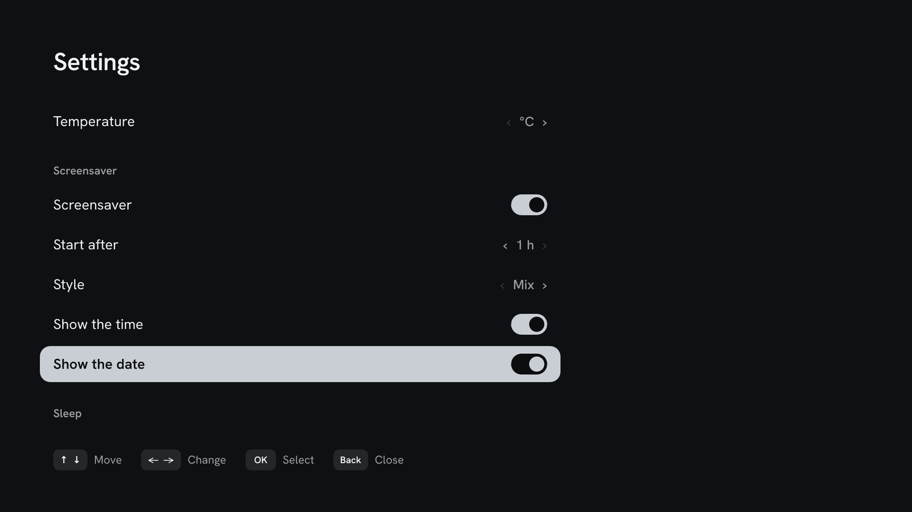

<p align="center">
  
</p>

<h1 align="center">rustv</h1>

<p align="center">
  <a href="https://github.com/cngil/rustv/actions/workflows/ci.yml"></a>
  <a href="LICENSE"></a>
</p>

<p align="center">
  A private, open-source TV shell for Linux.<br>
  Your living room without ads, tracking or lock-in.
</p>

---

Smart TV platforms like Tizen and Android TV ship ads on the home screen,
watch what you play, push updates you did not ask for and get slower every
year. rustv turns any Linux box (an old laptop, a mini PC) into a TV front
end that you own: it shows the apps you choose, does what you configure, and
talks to nobody but you.

**No new device needed.** rustv is just two small programs: `tvd`, a daemon
that runs your apps and serves the remote, and `rustv-shell`, the home
screen. Add them to the Linux machine you already have, plug it into the TV,
and your phone becomes the remote.

> **rustv is a shell, not a streaming service.** It plays nothing by itself
> and comes with no content, accounts or app store. It is the home screen,
> remote and glue around the Linux apps *you* choose to put on it. See
> [what people put on it](#what-to-put-on-it).

<p align="center">
  <br>
  <a href="docs/media/rustv-demo.mp4"><b>Watch the full one-minute demo</b></a>
</p>

<p align="center">
  
</p>

<table>
  <tr>
    <td width="33%"></td>
    <td width="33%"></td>
    <td width="33%">
      <br><br>
      <br><br>
      
    </td>
  </tr>
  <tr>
    <td align="center">Phone remote</td>
    <td align="center">Settings, saved to your config</td>
    <td align="center">Screensavers and the debug overlay</td>
  </tr>
</table>

<details>
<summary>Settings on the TV, for the TV remote alone</summary>

</details>

<details>
<summary>The remote on a computer</summary>

</details>

> **Status:** early development. The daemon, the web remote and a first
> on-screen shell work today. See the [roadmap](#roadmap).

## Principles

- **Private by design.** No telemetry, no accounts, no cloud, no analytics.
  rustv never connects to the internet; only the apps you launch do.
  The API listens on your LAN, protected by a token.
- **Yours to shape.** Every app, button and limit lives in one plain TOML
  file. Nothing is hardcoded, nothing is promoted, nothing is hidden.
- **Light.** Built for low-end hardware. The daemon is a ~3 MB binary that
  uses about 5 MB of RAM and no CPU while idle.
- **Open.** GPL-3.0. Read it, change it, fork it.
- **Scriptable.** One small JSON API for the remote, the shell, your scripts
  and, later, AI agents and voice control.

## What works today

- **On-screen shell** (`rustv-shell`, Rust + Slint): a home screen with big
  app cards, real app icons, a clock and a volume overlay, each switchable in
  the config. Arrow keys and OK from the remote are all you need; no pointer,
  no cursor.
- **Lock with a PIN**: lock the TV from the remote (or automatically when it
  sleeps); until the PIN is entered on a remote, nothing works. For children
  and guests, not a network defense: the pairing token is that.
- **Network overview** in the remote's settings: every port the box listens
  on, on which address, and which program owns it.
- **Look**: graphite surfaces with one metal. Whatever is selected or
  primary (the focused app, OK, a switch that is on) is a solid plate of it;
  nothing glows. Four finishes (silver, titanium, champagne, gunmetal) or
  your own colors, picked from the remote; the TV and the remote change
  together. Older color presets in a config still load.
- **Media keys** in the remote: play/pause, previous, next and ±10 s, sent
  to the player over MPRIS (Firefox, Jellyfin, VLC…) or as keys otherwise.
- **Sleep timer** from the remote: 15 minutes to 2 hours.
- **Volume per app**: each app and the home screen keep their own level, and
  the home screen's volume bar shows over apps too.
- **Brightness**, from the remote or the TV's settings: dims the picture in
  software (sway's gamma), handy in the evening. It cannot go brighter than
  the TV's own backlight setting; if rustv stops, full brightness comes back.
- **Night light and night mode**: warmer colors with less blue, all day or
  only at night. Night mode dims and warms the screen between two times of
  day (`[night]`), easing in and out over half an hour, from the remote or
  the TV's settings.
- **Gamepads as remotes**: pair one over Bluetooth (or plug it in) and move
  around the home screen with it; the Guide button closes the open app.
- **Wi-Fi and Bluetooth** in the remote's settings: join a network, pair
  headphones or a gamepad. Changing Wi-Fi needs the polkit rule in
  `packaging/polkit`.
- **Languages**: English and Turkish on the TV, the remote and the overlay,
  with a 24 or 12 hour clock and °C or °F, switchable from the remote. All
  texts live in one catalog per language (`crates/locales/<lang>.toml`),
  shared by every screen.
- **UI sounds**: soft, generated clicks when moving between apps and opening
  one (no audio files shipped). Level or off in the settings.
- **QR pairing**: the home screen shows a QR code until the first phone
  connects; scan it and the phone is a remote. To add another device, tap
  "Show code" in the remote's settings. `tvd pair` prints the same code in
  the terminal.
- **Screensaver**: after a few idle minutes on the home screen, the time
  drifts over generated animation (soft drifting lights, a turning galaxy of
  points, or just a large clock), different each time. Nothing to set up, no
  images, no network; any key wakes it. Or a slideshow of your own pictures.
- **Wallpaper**: list your own pictures (files or folders) in the config and
  they rotate behind the home screen, crossfading every 30 minutes, and in the
  screensaver, where each one slowly zooms in. Phone photos come out upright.
  Interval, order and where they show are switchable in the remote.
- **AirPlay**: mirror an iPhone, iPad or Mac, or play its videos and music
  on the TV, through [UxPlay](https://github.com/FDH2/UxPlay). Off by
  default; turn it on in the config or the remote's settings. If a phone
  leaves without ending the stream, its last picture goes away within
  about 20 seconds.
- **Sleep**: after an hour with no remote input and no sound, the screen
  turns off (most TVs then go to standby) and the open app closes, freeing
  its memory and CPU. Any button wakes it. A film playing never counts as
  unused. The box itself stays on, so the remote can always wake it.
- **HDMI-CEC** (optional, off by default): rustv waking turns the TV on and
  switches it to rustv, and sleep puts the TV in standby (unless it shows
  another input, such as a console). Turning the TV off puts rustv to sleep,
  and the TV remote's arrows, OK, Back, play and volume buttons control rustv
  (its Setup button opens the settings on the TV).
  Needs a CEC adapter the kernel knows (`/dev/cec*`): a Raspberry Pi, some
  NUCs, a DisplayPort adapter with CEC tunneling, or a Pulse-Eight USB adapter
  through `inputattach --pulse8-cec`. Most PC graphics cards have none.
- **On-screen keyboard**, for typing a search or an address with only the TV
  remote or a gamepad: hold OK on the TV remote (over HDMI-CEC) or hold the
  gamepad's Guide button. Arrows move, OK types the key into the app, Back
  closes, Enter sends and closes. It shows over full screen apps and never
  takes their focus. In Turkish it has the Turkish Q letters.
- **Resolution and refresh rate**, picked from the modes the TV offers, in the
  remote's settings or on the TV. A new mode applies at once and goes back by
  itself after 15 seconds unless kept, so a mode the TV cannot show never
  leaves you with a black screen; only a kept mode is saved
  (`display.mode`). The prompt to keep it shows over open apps too, and OK
  or Back answers it from any remote.
- **Now playing**: what a media player plays (title, artist, position and
  its cover) on the home screen and the remote, from any MPRIS player
  (Firefox, Jellyfin, Spotify, VLC…). Covers are only shown when the player
  keeps them in a file; nothing is fetched from the internet
  (`shell.now_playing`).
- **The box from the sofa**: the remote's System settings show what the TV
  shows (a screenshot to look at or save, never while locked), how long
  the box has run, its temperatures, memory and disk, and tvd's recent log
  (`[system]`).
- **Settings on the TV**: a Settings tile after the apps (or the Menu key)
  opens the settings on the TV itself, moved through with the arrows, for
  whoever has only the TV remote or a gamepad. The same changes as from the
  phone, saved to the config. Wi-Fi, Bluetooth, the PIN and custom colors
  need typing and stay on the phone. The tile can be switched off from the
  phone (`shell.settings`).
- **Arrange apps** from the remote: hold an app in the dock and drag it
  without letting go; the TV follows at once, and the order survives
  restarts. Let go without dragging (or right-click it on a computer) for
  its menu: open or close it on the TV, see what it is, move it, or remove
  it from the home screen. Removed apps stay in the config and come back
  from Settings.
- **`tvd` daemon**: launches and closes apps, one at a time; when an app
  exits you are back home.
- **Three kinds of apps**: Flatpak apps, any command, and web apps (a URL
  opened full screen in a kiosk browser, handy for qBittorrent or router
  panels).
- **Web remote** for phone and computer, nothing to install:
  - D-pad, OK and Back that hold their key for as long as you hold them, so
    apps see a real long press and a held arrow repeats; Home, Play
  - Touchpad with acceleration, tap to click, two-finger scroll and right click
  - On a computer: take over the TV pointer with your mouse (pointer lock)
    and forward your keyboard
  - App dock with icons, text input
  - One volume control with mute, and an output picker (your TV by name,
    headphones, Bluetooth) right under the D-pad
  - Shows progress and the result of every action (opening an app,
    switching the output, losing the connection)
  - Settings panel (gear button): home screen items, screensaver, volume
    limit and step, debug overlay. Changes apply at once and are written
    into your `config.toml`, comments and all
  - Installable as an app (PWA)
- **Debug overlay**: one line of live stats on top of everything, even full
  screen video: CPU and GPU load and temperature, RAM, network speed, Wi-Fi
  signal, display mode, volume, connected remotes, uptime. Items turn yellow
  or red when something runs hot. Pick the items in the config, switch it
  from the remote or the API.
- **Virtual keyboard and mouse** through `uinput`, so control works in every
  app without app support. Text from the phone and the on-screen keyboard is
  typed through sway's virtual keyboard with a layout made for it, so any
  character arrives (ğ, ş, é, ß, emoji), whatever layout the box has; without
  it, tvd falls back to the US layout.
- **Audio** through PipeWire: volume and output selection.
- **Night audio**: a real compressor (PipeWire filter-chain with the SWH `sc4`
  compressor and a lookahead limiter) between the apps and the output, so
  explosions come down and voices come up. Switch it on for good or only
  during night mode's hours. Needs `sudo apt install swh-plugins`; the
  output picker and the volume keep working as before.
- **App icons**: Flatpak apps bring their own; any app can set one.

## What to put on it

Anything that runs on Linux can be a tile: a Flatpak, a command or a web
page. Some setups that work well:

| You want | Put on it | Kind |
| --- | --- | --- |
| Your own film and series library | [Jellyfin](https://jellyfin.org) Desktop (`org.jellyfin.JellyfinDesktop`) with a Jellyfin server at home | flatpak |
| PC games on the TV | [Moonlight](https://moonlight-stream.org) (`com.moonlight_stream.Moonlight`) streaming from your gaming PC with Sunshine | flatpak |
| Local files, network shares, IPTV lists | [VLC](https://www.videolan.org/vlc/) (`org.videolan.VLC`) or [mpv](https://mpv.io) (`io.mpv.Mpv`) | flatpak, or a command such as `mpv --fs list.m3u` |
| YouTube without ads or tracking | [FreeTube](https://freetubeapp.io) (`io.freetubeapp.FreeTube`) | flatpak |
| Steam games from another PC | [Steam Link](https://store.steampowered.com/remoteplay) (`com.valvesoftware.SteamLink`) | flatpak |
| Plex or Kodi, if that is your library | Plex HTPC (`tv.plex.PlexHTPC`), Kodi (`tv.kodi.Kodi`) | flatpak |
| Retro games | [RetroArch](https://www.retroarch.com) (`org.libretro.RetroArch`) or small games such as KDE's Kapman and KBlocks | flatpak |
| Dashboards and web UIs | Home Assistant, qBittorrent, your router, any website | web |
| Phone and Mac screens | AirPlay, built in (`[cast] airplay = true`) | built in |

The author's own box runs Jellyfin for films and series and Moonlight for
games, plus qBittorrent's web UI and a few retro games. Start with the one
or two apps you actually use; every tile is three lines in the config.

## How it works

```
 phone / computer / scripts
            │  WebSocket + REST (token)
            ▼
 ┌────────────────────────┐        ┌──────────────────────┐
 │ tvd (user service)     │ starts │ apps on the TV       │
 │  app manager           ├───────►│ Jellyfin, Stremio,   │
 │  uinput keyboard/mouse │        │ Moonlight, browser…  │
 │  PipeWire volume       │        └──────────────────────┘
 │  web remote, API       │                  ▲
 └────────────────────────┘                  │ Wayland
                                    ┌────────┴─────────┐
                                    │ sway (kiosk)     │
                                    │ + rustv-shell    │
                                    └──────────────────┘
```

`tvd` holds all logic. The shell is a thin client of the same API as the
remote, so a crashed screen never takes the remote down.

## Requirements

- Linux with [sway](https://swaywm.org) on the TV output, used as a kiosk
  (no bars, no decorations, no keybindings; see [`packaging/sway/rustv.conf`](packaging/sway/rustv.conf)).
  sway picks the output mode, which matters on 4K TVs that only do 30 Hz over HDMI 1.4.
  The debug overlay uses swaybar, which ships with sway.
- PipeWire (`wpctl`, `pw-dump`) for audio
- Write access to `/dev/uinput` (see below)
- Flatpak for Flatpak apps, Firefox (Flatpak) for web apps by default
- For HDMI-CEC (optional): a CEC adapter at `/dev/cec*` and your user in the
  group that owns it (usually `video`)
- For AirPlay (optional): `uxplay` and `avahi-daemon`
  (`sudo apt install uxplay avahi-daemon gstreamer1.0-plugins-bad gstreamer1.0-libav`),
  and, behind a firewall, TCP 7000, 7001, 7100 and UDP 5353, 6000, 6001, 7011 open to your LAN
- Rust 1.80+ and, for the shell, fontconfig and xkbcommon headers
  (`sudo apt install libfontconfig1-dev libxkbcommon-dev` on Debian/Ubuntu)

## Install

```sh
git clone https://github.com/cngil/rustv && cd rustv

# allow virtual input devices for your user
sudo install -m644 packaging/udev/60-rustv-uinput.rules /etc/udev/rules.d/
echo uinput | sudo tee /etc/modules-load.d/uinput.conf
sudo usermod -aG input "$USER"   # log in again afterwards

./scripts/install.sh             # builds, installs the user service, prints the pairing link
loginctl enable-linger "$USER"   # start at boot without logging in

# show the shell on the TV (edit YOUR_USER and the uid in the unit first)
install -Dm644 packaging/sway/rustv.conf ~/.config/rustv/sway.conf
install -Dm644 packaging/xdg-desktop-portal/portals.conf ~/.config/xdg-desktop-portal/portals.conf
sudo install -m644 packaging/systemd/rustv-session.service /etc/systemd/system/
sudo systemctl enable --now rustv-session
```

Optional, recommended: with Avahi the remote opens at
`http://<hostname>.local:8765` and pairing keeps working if the box gets a
new IP. The service file also announces it to apps that browse the network:

```sh
sudo apt install avahi-daemon
sudo install -m644 packaging/avahi/rustv.service /etc/avahi/services/
```

The `portals.conf` matters: without it, a box with no desktop environment
makes every Flatpak app wait ~25 seconds for a portal backend that never
starts.

Scan the QR code on the TV (or the one `tvd pair` prints) with your phone,
or open the printed link (`http://<box>:8765/#token=…`), and add the page to
the home screen. Run `tvd pair` any time to see it again.

## Configure

`~/.config/rustv/config.toml`, fully documented in
[`config/config.example.toml`](config/config.example.toml):

```toml
[[app]]
id = "jellyfin"
name = "Jellyfin"
kind = "flatpak"
app_id = "org.jellyfin.JellyfinDesktop"
args = ["--tv", "--fullscreen"]

[[app]]
id = "qbittorrent"
name = "qBittorrent"
kind = "web"
url = "http://localhost:8080"

[[app]]
id = "live-tv"
name = "Live TV"
kind = "command"
command = ["mpv", "--fs", "/home/you/iptv.m3u"]
```

Everything the shell shows can be switched off:

```toml
[shell]
greeting = true
clock = true
date = false
volume_overlay = true
```

The order you arrange apps in from the remote is kept in
`~/.local/state/rustv/app-order`, separate from the config: the config says
which apps exist, that file only where they go. Apps it does not list appear
at the end in config order. Delete it to go back to the config order.
Apps removed from the home screen are listed in
`~/.local/state/rustv/hidden-apps` the same way; delete it to bring them all back.

The remote's settings panel edits the same file. It can only change the
home screen, screensaver, audio and overlay sections; apps, the server and
the browser stay in your hands. A change is saved only if the whole file
still passes `tvd check`.

The volume stops at 100% unless you raise `audio.max_volume`; above 100%
PipeWire boosts the signal in software, which can distort.

Web apps are ordinary websites, often made for a desk, not a couch. To make
them all larger, add this to the kiosk browser's `user.js` (for Flatpak
Firefox, in its profile under `~/.var/app/org.mozilla.firefox/`):

```js
user_pref("layout.css.devPixelsPerPx", "1.5");
```

Check it with `tvd check`, then `systemctl --user restart tvd`.

## API

All endpoints except `/api/v1/health` need `Authorization: Bearer <token>`
(WebSocket clients may pass `?token=`). The token is in
`~/.config/rustv/token`.

| Method | Path | |
| --- | --- | --- |
| `GET` | `/api/v1/state` | Running app, volume, seconds since last input, overlay, connected clients |
| `GET` | `/api/v1/apps` | Configured apps, in order (`hidden` when removed from the home screen; `source`: Flatpak ID, web origin or program name) |
| `GET` | `/api/v1/apps/{id}/icon` | App icon (SVG, PNG or JPEG) |
| `GET` | `/api/v1/wallpapers/{n}` | Picture `n` of `[wallpaper] images` (JPEG or PNG) |
| `GET` | `/api/v1/audio` | Audio outputs and volume limits |
| `GET` | `/api/v1/network` | Ports the box listens on, with address and program |
| `GET` | `/api/v1/now_playing/art` | Cover of what plays, when the player keeps it in a local file |
| `GET` | `/api/v1/screenshot` | What the TV shows, as PNG (`system.screenshot`; refused while locked) |
| `GET` | `/api/v1/system` | Uptime, load, temperatures, memory, disk and tvd's last log lines (`system.info`) |
| `POST` | `/api/v1/command` | Run one command (below) |
| `GET` | `/api/v1/ws` | WebSocket: send commands, receive `apps`, `audio` and `state` updates |

Commands are JSON objects tagged by `type`:

```json
{"type": "launch", "id": "jellyfin"}
{"type": "stop"}
{"type": "key", "code": "ArrowDown"}
{"type": "key", "code": "KeyF", "ctrl": true}
{"type": "key", "code": "Enter", "action": "down"}
{"type": "text", "text": "the expanse"}
{"type": "move", "dx": 40, "dy": -12}
{"type": "scroll", "dy": -2}
{"type": "button", "button": "left", "action": "click"}
{"type": "volume", "action": "up"}
{"type": "volume", "action": "set", "level": 0.6}
{"type": "audio_output", "id": 52}
{"type": "overlay", "visible": true}
{"type": "sleep"}
{"type": "display_mode", "mode": "1920x1080@60"}
{"type": "display_keep"}
{"type": "display_revert"}
{"type": "keyboard", "open": true}
{"type": "sleep_timer", "minutes": 30}
{"type": "media", "action": "play_pause"}
{"type": "media", "action": "seek", "seconds": -10}
{"type": "show_pairing"}
{"type": "set_pin", "pin": "2468"}
{"type": "lock"}
{"type": "unlock", "pin": "2468"}
{"type": "set", "key": "cast.airplay", "value": true}
{"type": "set", "key": "theme.preset", "value": "champagne"}
{"type": "set", "key": "theme.accent", "value": null}
{"type": "set", "key": "screensaver.idle_minutes", "value": 10}
{"type": "reorder", "ids": ["stremio", "jellyfin"]}
{"type": "hide_app", "id": "stremio", "hidden": true}
```

Key codes follow the browser's
[`KeyboardEvent.code`](https://developer.mozilla.org/docs/Web/API/UI_Events/Keyboard_event_code_values). A key's `action` is
`press` by default; `down` holds it until `up`. A held key is let go when its
remote disconnects, and after 30 seconds without an `up`.

```sh
curl -H "Authorization: Bearer $(cat ~/.config/rustv/token)" \
     -d '{"type":"launch","id":"jellyfin"}' http://localhost:8765/api/v1/command
```

## Security

The token gives full control of the TV's keyboard and mouse. Keep port 8765
on your LAN or a VPN such as Tailscale, and never forward it to the internet.
Delete `~/.config/rustv/token` and restart `tvd` to revoke all paired devices.

## Roadmap

- [x] Daemon: app launching, virtual input, volume, API
- [x] Web remote for phone and computer, with app dock and audio controls
- [x] On-screen shell (Rust + Slint): home screen, D-pad navigation, no cursor needed
- [x] App icons
- [x] Screensaver: generated animation with a drifting clock
- [ ] Now playing card, Spotify Connect through `spotifyd`
- [x] Themes: four metal finishes or your own colors, on the TV and the remote
- [x] QR code pairing
- [x] mDNS: the remote at `http://<hostname>.local:8765`, announced on the network
- [ ] Agent integration (MCP) and voice commands
- [ ] Switching between running apps
- [x] UI redesign of the shell and the remote: graphite and one metal, one design language (see [DESIGN.md](DESIGN.md))

### Backlog

- [x] System info on screen: the debug overlay (CPU, GPU, RAM, network,
  Wi-Fi signal and more, each item switchable)
- [x] UI audio feedback (navigation and selection sounds)
- [x] Wi-Fi and Bluetooth from the remote (audio outputs already were)
- [x] Lock and unlock with a PIN; see the ports the box exposes
- [ ] Change exposed ports and addresses from the remote (today: in each
  program's config)
- [x] Reorder apps (from the remote)
- [x] Localization: English and Turkish, 24 or 12 hour clock, °C or °F
- [ ] More languages: one file each, `crates/locales/<lang>.toml` (see CONTRIBUTING)
- [x] Screen casting with AirPlay (iPhone, iPad, Mac)
- [x] HDMI-CEC: TV power follows rustv and the other way round, TV remote buttons
- [ ] Screen casting from Android and Windows (Google Cast, Miracast); there
  is no dependable open-source receiver yet

## Development

```sh
cargo test
cargo clippy --all-targets -- -D warnings
cargo fmt --check
RUST_LOG=debug cargo run -p tvd -- --config config/config.example.toml
```

Browser tests for the remote run against a real tvd with a throwaway config
(they need `/dev/uinput`, and never press keys on a real TV):

```sh
cargo build -p tvd
cd tests/remote && npm ci && npx playwright install chromium
npx playwright test
```

## License

[GPL-3.0-or-later](LICENSE). The shell and the remote bundle the
[Hanken Grotesk](https://github.com/marcologous/hanken-grotesk) typeface, licensed
under the [SIL Open Font License](crates/shell/ui/fonts/OFL.txt); the remote serves
it from the box, so nothing loads from the internet.
